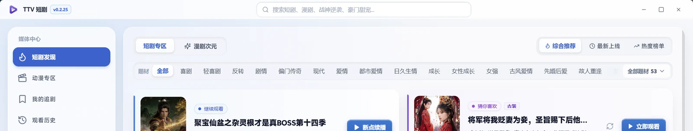
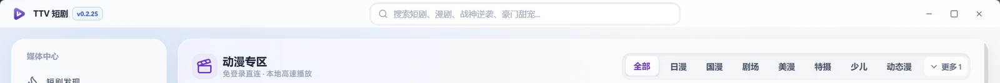
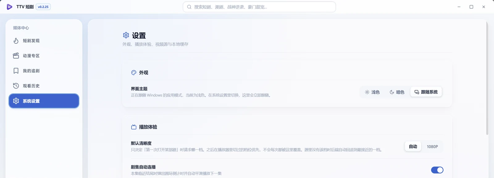

<div align="center">


# TTV Short Drama

### Windows / macOS 短剧、漫剧与动漫桌面播放器

一处发现想看的剧，从上次停下的地方接着看

**多频道浏览 · 沉浸式播放 · 自动连播 · 断点续播 · 画中画小窗 · 独立 MPV 补帧 · 自动更新**

**[⬇️ 前往 Releases 下载安装包](https://github.com/kiocou/TTV-Short-Drama/releases/latest)**

Windows 10 / 11 (x64 / ARM64) · macOS (Apple Silicon / Intel) · 免费无广告



</div>

## ✨ 主要功能

- 🎬 **多频道浏览**：短剧、漫剧、动漫各自成区，题材分类、排序与榜单随手切换。
- 🔍 **搜索与筛选**：输入剧名或题材快速缩小范围，支持搜索历史记录随时找回。
- 📋 **剧集详情与追剧**：封面、简介、标签与完整选集一目了然；详情页底部按季接续推荐（例如看完第 5 季优先衔接后续季）。
- ▶️ **沉浸播放与自动连播**：无边框窗口与悬浮控制栏，本集结束前倒计时平滑进入下一集。
- ⌨️ **键盘快捷键与操作反馈**：空格暂停、方向键快进快退、长按临时加速、`[` / `]` 切集、`F` 全屏，画面中央实时提示当前状态。
- 🪟 **画中画小窗**：置顶小窗继续播放，主窗口可以同时浏览其他剧集。
- ⚡ **独立 MPV 播放器（Windows）**：内置独立 `ttv-player`（`libmpv`），支持显卡运动补偿补帧（2X–5X）、画面填充/裁切/拉伸、音轨与字幕切换、A-B 循环及单独截图。
- 💾 **断点续播与本地缓存**：自动保存看到哪一集、看到哪里；支持观看历史搜索清理、追剧收藏与本地缓存管理。
- 🎨 **主题外观**：支持浅色、暗色与跟随系统，Windows 11 呈现 Mica 通透质感。
- 🔄 **应用内自动更新**：自动识别当前系统与芯片架构，支持国内网络自动选路（直连 / 镜像加速）、分片并发下载与 SHA-256 完整性校验。

## 📸 界面预览

| 动漫专区 | 播放器控制栏 |
|---|---|
|  |  |
| **观看历史** | **设置与网络诊断** |
|  |  |

## 📥 下载与安装

前往本仓库的 **[Releases](https://github.com/kiocou/TTV-Short-Drama/releases/latest)** 页面，根据你的系统与芯片架构选择对应安装包：

| 平台 | CPU 架构 | 安装包文件名后缀 | 说明 |
|---|---|---|---|
| Windows 10 / 11 | x64 (`x86_64`) | `*-x64-setup.exe` | 完整功能（含独立 MPV 播放器、补帧及全部内置源） |
| Windows 11 | ARM64 (`aarch64`) | `*-arm64-setup.exe` | 原生 ARM64 主程序，内置播放器与 Rust 原生源全功能 |
| macOS | Apple Silicon (`M` 系列 / `aarch64`) | `*_aarch64.dmg` | 原生 Apple Silicon 安装镜像，使用内置播放器播放 |
| macOS | Intel (`x64`) | `*_x64.dmg` | Intel Mac 安装镜像，使用内置播放器播放 |

### Windows 安装说明

1. 下载对应的 `*-setup.exe` 安装程序，双击按向导完成安装。
2. 如遇「Windows 已保护你的电脑」SmartScreen 提示，点击 **更多信息 → 仍要运行**（个人开源项目未购买商业代码签名证书）。
3. 后续有新版本时，可在应用顶部版本号或「设置 → 关于」中点击检查更新，程序会自动下载对应架构安装包并校验 SHA-256。

### macOS 安装说明

1. 下载对应芯片架构的 `.dmg` 镜像（M 系列芯片选 `aarch64`，Intel 芯片选 `x64`），打开后将应用拖入「应用程序」。
2. 应用未经过 Apple 公证签名，首次打开若提示「已损坏」或「无法验证开发者」，可在终端执行以下命令后重新打开：

```bash
xattr -cr "/Applications/TTV Short Drama.app"
```

## ❓ 常见问题与已知边界

**为什么没有清晰度多档位或播放源切换？**
- 部分上游数据源只返回一路有效码流与一条可用解析链路，程序按真实可得能力如实呈现，不做无效的空开关。

**独立 MPV 播放器 / 补帧 / 增强为什么仅在 Windows 可用？**
- 独立 `ttv-player`（`libmpv-2.dll`）、GPU 运动补偿补帧与 RTX VSR 依赖 Windows 图形管线；macOS 自动使用内置 WebView 播放器。
- 开启补帧（2X–5X）时，实际呈现帧率受显示器刷新率与 GPU 算力上限约束，界面显示的是**实测倍率**。

**遇到目录加载失败或封面空白怎么办？**
- 可前往 **设置 → 网络诊断** 检测系统代理与链路连通性；若开启了系统代理或 Clash / v2rayN 等本地代理，程序会自动探测并适配境外资源链路。

**遇到问题如何反馈？**
- 欢迎在本仓库提交 [Issue](https://github.com/kiocou/TTV-Short-Drama/issues/new/choose)，提交时请附上程序版本号（设置页可见）、系统类型以及出问题的剧名 / 集数或截图。

## ⚠️ 说明

- 本仓库**只用于发布安装包与说明文档，不包含源代码**。
- 本应用仅提供播放器与本地管理功能，不存储、不托管、不传播任何视频内容。
- 剧集信息与媒体内容来自第三方，版权归各自权利人所有，请勿用于商业用途。
- 请仅将本应用用于个人学习与合法用途，并遵守所在地区的法律法规。

## 🙏 致谢

感谢以下开源项目与社区在协议研究、桌面端能力与社区交流方面提供的帮助：

- **[beilunyang/openhongguo](https://github.com/beilunyang/openhongguo)**（Apache-2.0）：红果协议 Rust 客户端实现的协议语义参考与移植基线
- **[Tauri](https://github.com/tauri-apps/tauri)** / **[React](https://github.com/facebook/react)** / **[Vite](https://github.com/vitejs/vite)** / **[Tailwind CSS](https://github.com/tailwindlabs/tailwindcss)**：跨平台桌面应用框架与前端构建技术栈
- **[mpv](https://github.com/mpv-player/mpv)** / **[FFmpeg](https://github.com/FFmpeg/FFmpeg)** / **[hls.js](https://github.com/video-dev/hls.js)** / **[lucide](https://github.com/lucide-icons/lucide)**：视频播放渲染、转码补帧与界面图标支持
- **[bogdanfinn/tls-client](https://github.com/bogdanfinn/tls-client)** / **[bogdanfinn/fhttp](https://github.com/bogdanfinn/fhttp)**：站源网络适配工具库
- **[yangbin1322/hongguo-player](https://github.com/yangbin1322/hongguo-player)**：公开分发仓库结构与发布文档组织参考
- 感谢 **[linuxdo](https://linux.do/)** 社区的交流、分享与反馈

## ⭐ 如果对你有帮助

欢迎点个 Star ⭐ 支持一下，也欢迎在 Issues 中提出建议或反馈问题。
