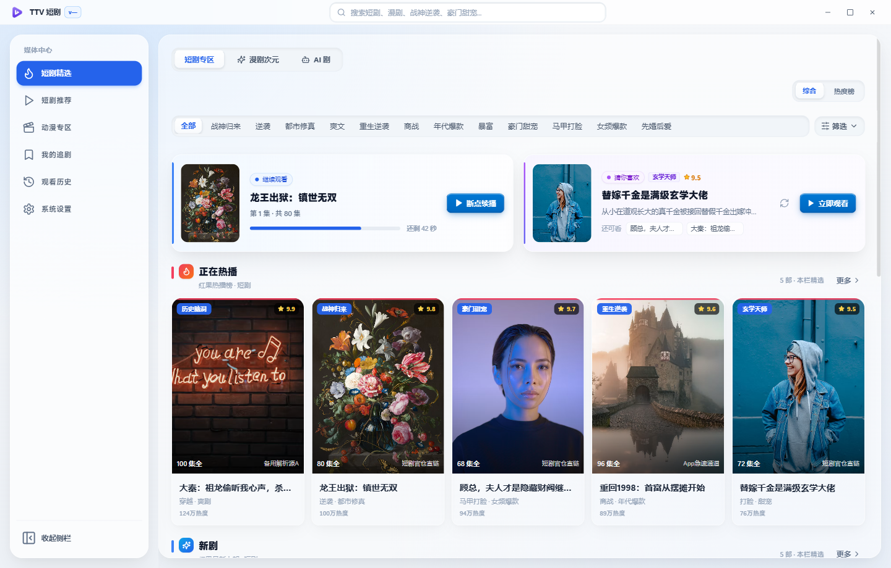
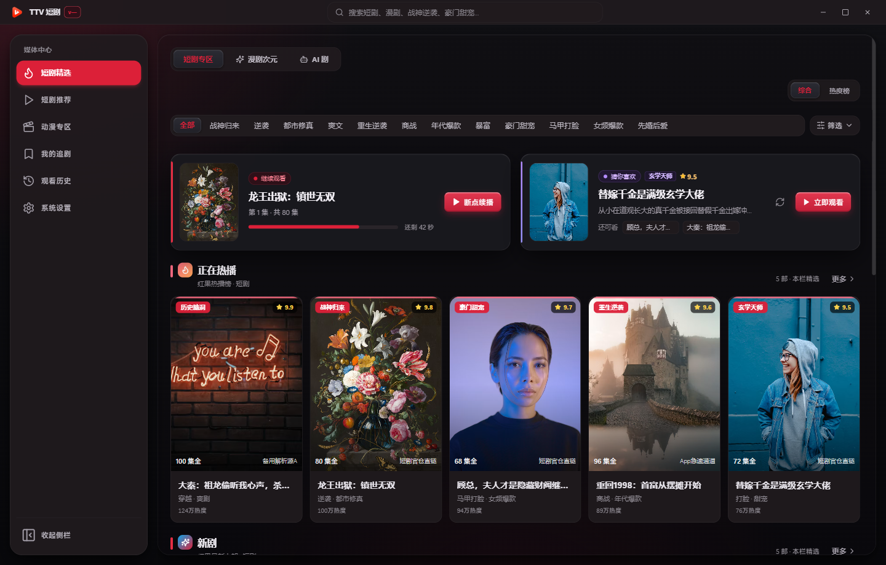
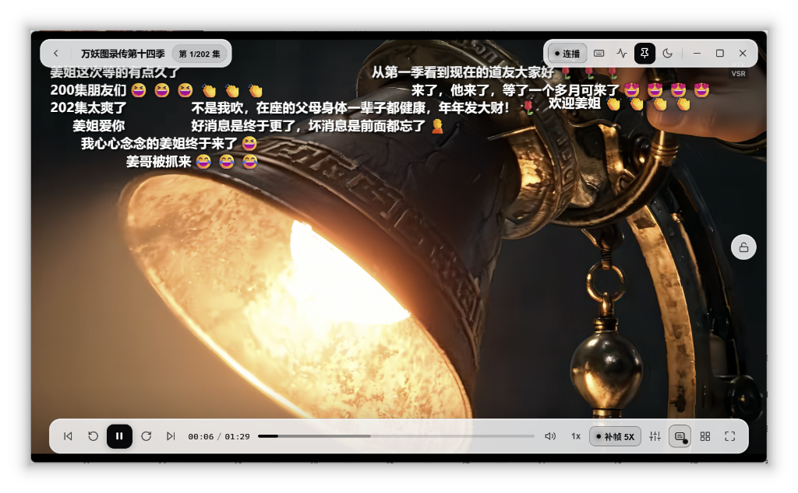
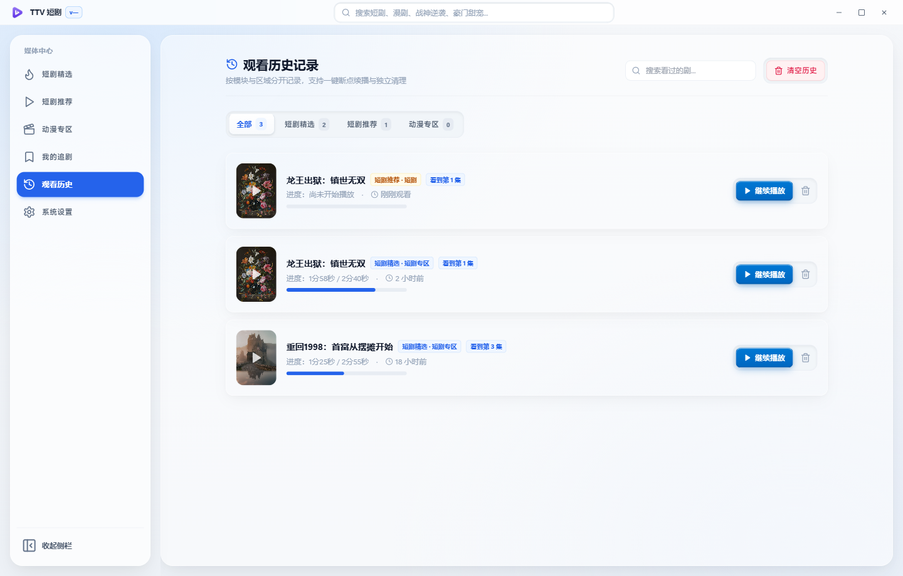
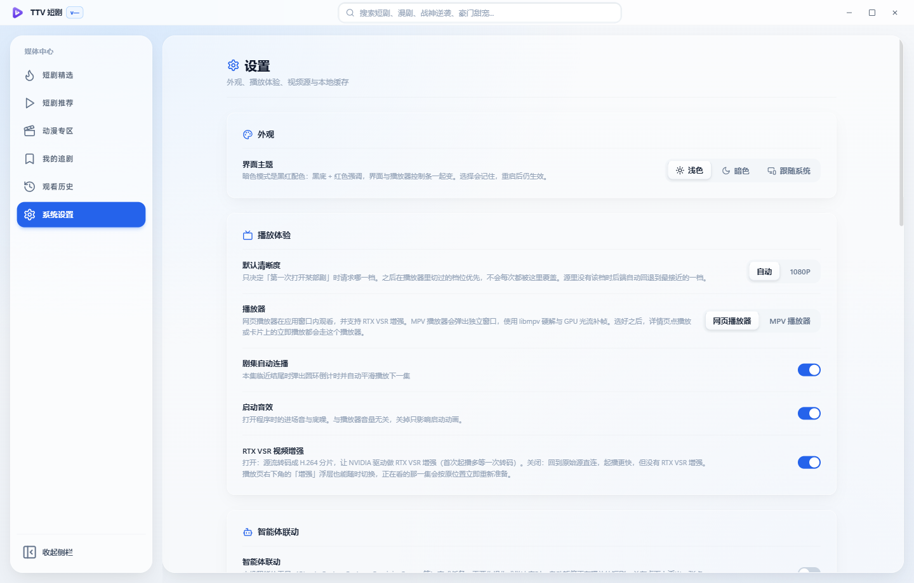
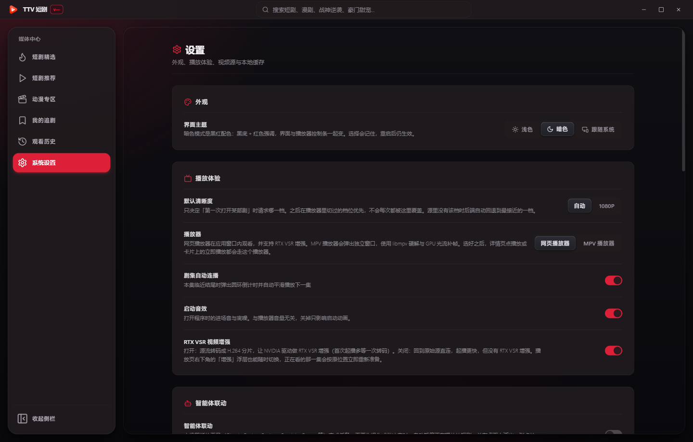

<div align="center">


# TTV Short Drama

### 跨平台短剧、漫剧与动漫桌面播放器（Windows & macOS）

一处发现想看的剧，从上次停下的地方接着看

<p>
  <a href="https://github.com/kiocou/TTV-Short-Drama/releases">
    
  </a>
  
  
  <a href="https://github.com/kiocou/TTV-Short-Drama-Source">
    
  </a>
</p>



</div>

## ✨ 核心体验

- 🎬 **多频道发现与榜单**：短剧专区、漫剧次元、AI 剧、动漫专区一处浏览，支持题材标签、综合/热度排序、全站搜索与历史检索。
- ▶️ **竖滑沉浸推荐流**：类似短视频的上下滑动切剧体验，首屏预热、预加载下一集并支持随时收藏追剧。
- ⚡ **独立 MPV 播放器 + 显卡光流补帧（Windows）**：内置独立 `ttv-player`（`libmpv` + DirectComposition + GPU 4 级光流补帧 2X–5X），支持弹幕、表情映射、A-B 循环、画面适应/填充/拉伸与无边框透明 HUD。
- 🔍 **剧集详情与系列季**：支持分段选集、未观看筛选、跳集直达、跨季切换与「猜你喜欢」接续推荐。
- 💾 **断点续播与分区历史**：自动区分短剧精选、短剧推荐、动漫专区的观看进度，回到首页一键「继续观看」。
- 🎨 **浅色 / 暗色双主题**：支持浅色、暗色（黑红强调配色）与跟随系统切换，主窗与独立播放器控制栏同步联动。
- 🤖 **智能体联动（可选）**：支持接入本地 AI 编程工具（Claude Code / Codex / Gemini / Cursor 等）事件状态悬浮卡。
- 🔄 **应用内自动更新**：自动匹配当前操作系统与 CPU 架构，支持国内网络自动选路、分片并发下载与 SHA-256 校验。

## 📸 界面预览

| 暗色模式发现页 | 剧集详情与分段选集 |
|---|---|
|  |  |
| **独立 MPV 播放器（5X 补帧 + 弹幕）** | **分区观看历史与断点续播** |
|  |  |
| **系统设置（浅色）** | **系统设置（暗色）** |
|  |  |

## 📥 下载与安装

前往本仓库的 **[Releases](https://github.com/kiocou/TTV-Short-Drama/releases)** 页面选择对应系统与芯片架构的安装包：

| 平台 | CPU 架构 | 安装包后缀 | 功能说明 |
|---|---|---|---|
| Windows 10 / 11 | x64 (`x86_64`) | `*-x64-setup.exe` | 完整功能（含独立 MPV 播放器、GPU 补帧、RTX VSR 与全部内置源） |
| Windows 11 | ARM64 (`aarch64`) | `*-arm64-setup.exe` | 原生 ARM64 主程序，支持内置播放器与纯 Rust 原生源全功能 |
| macOS | Apple Silicon (`M` 系列 / `aarch64`) | `*_aarch64.dmg` | 原生 Apple Silicon 安装镜像，使用内置播放器播放 |
| macOS | Intel (`x64`) | `*_x64.dmg` | Intel Mac 安装镜像，使用内置播放器播放 |

### Windows 安装提示

1. 运行对应的 `*-setup.exe`，按安装向导完成安装（升级覆盖时支持在应用内直接发起更新）。
2. 若出现 **Windows 已保护你的电脑**（SmartScreen 提示），点击 **更多信息 → 仍要运行**（个人非商用项目未购买商业代码签名证书）。

### macOS 安装提示

1. 打开对应架构的 `.dmg`（M1/M2/M3/M4 选 `aarch64`，Intel 选 `x64`），将应用拖入 **应用程序（Applications）**。
2. 因应用未经过 Apple 付费开发者签名公证，首次打开若提示「已损坏」或「无法验证开发者」，在终端执行以下命令后即可正常启动：

```bash
xattr -cr "/Applications/TTV Short Drama.app"
```

## ❓ 常见问题与已知边界

- **为什么独立 MPV / 光流补帧 / RTX VSR 仅支持 Windows？**
  - 独立 `ttv-player`（DirectComposition + HLSL GPU 光流补帧）与 NVIDIA RTX VSR 依赖 Windows 图形管线；macOS 会自动使用内置 WebView 播放器观看，其余选集、追剧、搜索、历史与纯 Rust 原生源体验一致。
- **为什么部分剧集没有多档清晰度或播放源切换？**
  - 当上游接口仅返回单一码流或单一可用解析链路时，程序会如实隐藏无效切换开关。
- **目录加载失败或封面空白怎么办？**
  - 请进入 **系统设置 → 网络诊断** 检查连通性；程序支持自动探测本地代理（如 Clash / v2rayN）并切换兜底线路。
- **如何查看源代码或反馈问题？**
  - 公开源码仓库位于 **[`kiocou/TTV-Short-Drama-Source`](https://github.com/kiocou/TTV-Short-Drama-Source)**（**PolyForm Noncommercial 1.0.0** 非商用协议）。
  - 使用异常或崩溃反馈请在本仓库提交 **[Issue](https://github.com/kiocou/TTV-Short-Drama/issues/new/choose)**，并附上系统版本、应用版本号及操作截图。

## ⚠️ 免责与非商用说明

- 本仓库**仅用于发布多平台安装包与使用文档**，不包含应用源代码。
- 本软件按 **PolyForm Noncommercial License 1.0.0** 分发，**严禁任何商业用途、倒卖或收费分发**。
- 本应用仅作为本地播放器与目录检索客户端，不存储、不托管、不传播任何音视频媒体内容；全部剧集与媒体数据版权归各自权利人所有，请仅用于个人学习与合法用途。

## 🙏 致谢

- **[beilunyang/openhongguo](https://github.com/beilunyang/openhongguo)**（Apache-2.0）：红果协议 Rust 客户端实现的协议语义参考与移植基线
- **[Tauri](https://github.com/tauri-apps/tauri)** / **[React](https://github.com/facebook/react)** / **[Vite](https://github.com/vitejs/vite)** / **[Tailwind CSS](https://github.com/tailwindlabs/tailwindcss)**
- **[mpv](https://github.com/mpv-player/mpv)** / **[FFmpeg](https://github.com/FFmpeg/FFmpeg)** / **[hls.js](https://github.com/video-dev/hls.js)** / **[lucide](https://github.com/lucide-icons/lucide)**
- **[bogdanfinn/tls-client](https://github.com/bogdanfinn/tls-client)** / **[bogdanfinn/fhttp](https://github.com/bogdanfinn/fhttp)** / **[yangbin1322/hongguo-player](https://github.com/yangbin1322/hongguo-player)**
- 感谢 **[linuxdo](https://linux.do/)** 社区的交流与反馈
